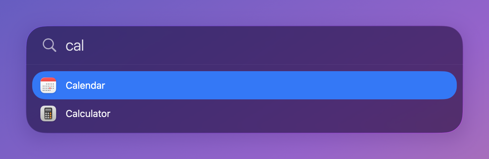
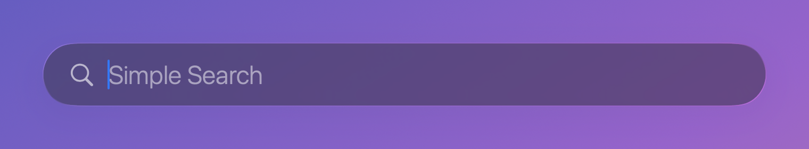
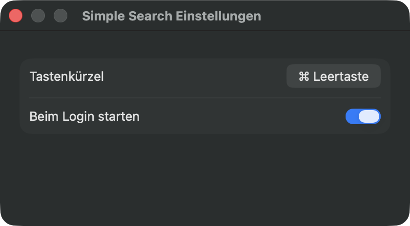

# Simple Search for Mac

Simple Search is a small app launcher for macOS, a stripped-down Spotlight that does one thing: find an app and start it. Press a shortcut, type a few letters, press Return. There are no file results, no web search and no calculator. It uses Liquid Glass, opens with a short spring animation and is written in Swift (SwiftUI and AppKit) without any dependencies.



## Contents

- [Features](#features)
- [Download](#download)
- [Requirements](#requirements)
- [Building from source](#building-from-source)
- [Using Simple Search](#using-simple-search)
  - [Searching and starting apps](#searching-and-starting-apps)
  - [Keyboard](#keyboard)
  - [Settings](#settings)
  - [Using Command-Space](#using-command-space)
- [Project structure](#project-structure)
- [License](#license)

## Features

- A global shortcut opens a search field in the upper middle of the screen.
- Typing filters all installed apps at once. With an empty field only the field is shown, the list opens as soon as you type.
- Tab, Shift-Tab and the arrow keys move the selection, Return starts the app. No preview, no intermediate step.
- Liquid Glass look (`NSGlassEffectView`), fully rounded, adapts to light and dark mode.
- Opening: the window grows out of its center with a spring animation and a slight overshoot. Closing: it puffs up briefly, then shrinks to the center and fades out.
- No Dock icon and no menu bar icon. The app runs in the background.
- Settings for the shortcut and for starting at login.

## Download

A ready-built app is attached to the [latest release](https://github.com/SimonSmb30/simple_search_for_mac/releases/latest).

1. Download `Simple-Search-1.0.zip` from the release page and unzip it (double-click the file).
2. Move `Simple Search.app` into the Applications folder.
3. Start it. The first start is blocked, see below.

The app is not notarized by Apple, because that requires a paid developer account. macOS therefore refuses the first start with a message that it could not verify the app. To allow it:

1. Close the message with "Done".
2. Open System Settings > Privacy & Security and scroll down to the "Security" section.
3. Next to the note that "Simple Search" was blocked, click "Open Anyway" and confirm.

This is needed once. Alternatively, remove the download mark in Terminal before the first start:

```sh
xattr -dr com.apple.quarantine "/Applications/Simple Search.app"
```

The download is built for Macs with Apple silicon. If you would rather not run an app that Apple has not checked, build it yourself as described under [Building from source](#building-from-source).

## Requirements

- macOS 26 (Tahoe) or later. The Liquid Glass window needs it.
- Apple silicon for the download. Building from source on an Intel Mac has not been tried.
- Only for building from source: the Swift toolchain (Xcode or the Command Line Tools) with Swift 6.2 or newer.

## Building from source

```sh
git clone https://github.com/SimonSmb30/simple_search_for_mac.git
cd simple_search_for_mac
./build.sh
open "Simple Search.app"
```

`build.sh` compiles the Swift package in release mode, puts the result into `Simple Search.app` together with the icon and an `Info.plist`, and signs it ad hoc. Copy the app into the Applications folder to keep it. To quit the running app, use `pkill "Simple Search"`.

The icon is `icon.svg`, rendered into `AppIcon.icns`. The build script only copies the existing `AppIcon.icns`.

## Using Simple Search

### Searching and starting apps

Press the shortcut (default: ⌥ Space). Type part of an app name. The list shows the best matches first:

1. names that start with what you typed,
2. names with a word that starts with it,
3. names that contain it,
4. names that contain the letters in that order, for example `ssc` for "System Settings".

The first match is already selected. Press Return to start it. The window closes at once and does not wait for the app. The list is read from `/Applications`, `/System/Applications`, `/System/Cryptexes/App/System/Applications` (this is where Safari lives) and `~/Applications` each time the window opens.



### Keyboard

| Key | What it does |
| --- | --- |
| Shortcut (default ⌥ Space) | Opens and closes the window. |
| Tab, ↓ | Select the next app. After the last one it continues with the first. |
| Shift-Tab, ↑ | Select the previous app. |
| Return | Start the selected app. |
| Esc | Close the window. |
| ⌘, | Open the settings. |

A click outside the window closes it as well.

### Settings

There is no menu bar icon. Open the settings with ⌘, while the search window is open, or by opening the app a second time (from Finder, the Applications folder or Spotlight).



- **Keyboard shortcut** (Tastenkürzel): click the button, then press the new combination. It is saved at once. The combination must contain ⌘, ⌥, ⌃ or ⇧. Esc cancels. The shortcut is switched off while it is being recorded.
- **Start at login** (Beim Login starten): adds the app to the login items. This works most reliably when the app is in the Applications folder. If macOS refuses, the reason is shown below the switch, and you can also allow it in System Settings > General > Login Items.

The settings window is in German at the moment.

### Using Command-Space

The default is ⌥ Space so that it does not collide with Spotlight. To use ⌘ Space, switch off the Spotlight shortcut first (System Settings > Keyboard > Keyboard Shortcuts > Spotlight), then record ⌘ Space in the settings of Simple Search. In Terminal the Spotlight shortcut can be switched off with the command below; log out and in again if it does not take effect.

```sh
defaults write com.apple.symbolichotkeys AppleSymbolicHotKeys -dict-add 64 '{ enabled = 0; value = { parameters = (32, 49, 1048576); type = standard; }; }'
```

## Project structure

All source files are in `Sources/Launcher/`.

| File | Contents |
| --- | --- |
| `main.swift` | Start of the app, runs without Dock icon. |
| `Panel.swift` | App delegate: the glass window, keyboard handling, the open and close animations, and the settings window. |
| `SearchView.swift` | The SwiftUI search field and list, and the model behind them. |
| `AppIndex.swift` | Finds the installed apps and filters them. |
| `Hotkey.swift` | The global shortcut (Carbon `RegisterEventHotKey`, needs no extra permissions). |
| `Settings.swift` | Stored settings, recording of the shortcut, and the login item. |

`icon.svg` and `AppIcon.icns` are the app icon. `build.sh` builds the app. Settings are stored in the macOS defaults system under the bundle identifier `local.privat.launcher`; to reset them, quit the app and run `defaults delete local.privat.launcher`. Comments in the source code are written in German.

## License

MIT License, Copyright (c) 2026 Simon Schäfer. See [LICENSE](LICENSE).
